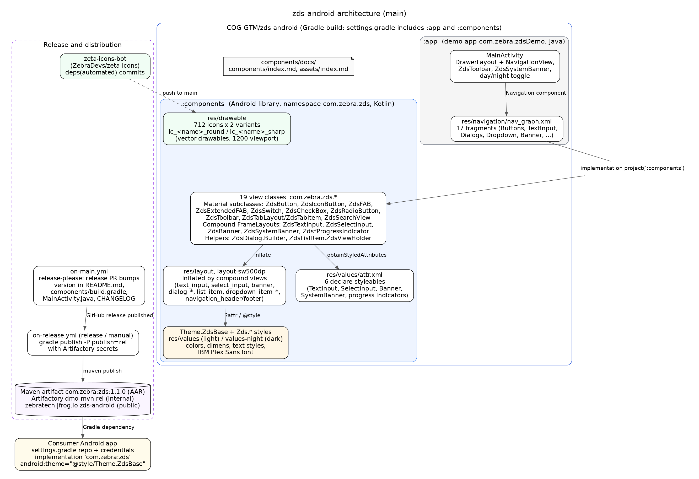

# zds-android architecture

This page describes what the code on `main` does today. The diagram source is
[`diagrams/architecture.dot`](./diagrams/architecture.dot); run
[`diagrams/render.sh`](./diagrams/render.sh) (needs Graphviz) to regenerate the PNG and SVG after editing it.

## Modules

`settings.gradle` includes two Gradle modules. Both target `compileSdk 34` / `minSdk 21` and use Android Gradle Plugin 8.7.1 with the Gradle 8.9 wrapper.

| Module | Type | Language | Package / namespace | Purpose |
| --- | --- | --- | --- | --- |
| `:components` | Android library (`com.android.library`, `maven-publish`) | Kotlin | `com.zebra.zds` | The Zebra Design System library, published as `com.zebra:zds` |
| `:app` | Android application | Java | `com.zebra.zdsDemo` | Demo app that shows every component; depends on `project(':components')` |

`:components` exposes `androidx.appcompat` and Material Components as `api` dependencies, so consumers get them transitively.

## `:components` library

### View classes (`components/src/main/java/com/zebra/zds`)

The library has 19 Kotlin classes. They fall into three groups:

- **Thin Material subclasses.** `ZdsButton`, `ZdsIconButton`, `ZdsFAB`, `ZdsExtendedFAB`, `ZdsSwitch`, `ZdsCheckBox`, `ZdsRadioButton`, `ZdsToolbar`, `ZdsTabLayout`, `ZdsTabItem` and `ZdsSearchView` extend the matching Material/AppCompat widget. They add little or no code; their look comes from the `Zds.*` styles applied in XML.
- **Compound views.** `ZdsTextInput`, `ZdsSelectInput`, `ZdsBanner`, `ZdsSystemBanner`, `ZdsLinearProgressIndicator` and `ZdsCircularProgressIndicator` extend `FrameLayout`. Each inflates its own layout from `res/layout` (for example `text_input.xml`) and reads its custom attributes from a `declare-styleable` in `res/values/attr.xml` through `obtainStyledAttributes`. They expose setters such as `setLabel`, `setError`, `setHint` and `setPlaceholder`.
- **Helpers.** `ZdsDialog` is a `Dialog` built through `ZdsDialog.Builder` (title, icon, content, up to three actions, sharp or rounded). It picks `dialog_action_one/two/three.xml`, with wider variants in `layout-sw500dp`. `ZdsListItem` provides a `list_item.xml` inflater and a `ZdsViewHolder` for `RecyclerView` lists.

Two components have no class of their own. The dropdown in the [component docs](../components/docs/components/index.md) is an AndroidX `ListPopupWindow` with the `dropdown_item_*` layouts and `Zds.Dropdown` style. The snackbar is a Material `Snackbar` styled through `snackbarStyle` in the theme.

### Theme and styles (`components/src/main/res`)

- `values/themes.xml` defines `Theme.ZdsBase` (parent `Theme.Material3.Light.NoActionBar`). It sets the colour roles, the default `materialButtonStyle`, `toolbarStyle`, `searchViewStyle`, `snackbarStyle`, the popup menu style, the IBM Plex Sans font family and every Material 3 text appearance (`TextAppearance.Zds.*`). Components only look right when the app (or activity) uses this theme.
- `values/styles-*.xml` hold the per-component `Zds.*` styles, for example `Zds.Button.Primary` and `Zds.Button.Primary.Sharp`. Most styles come in a rounded default and a `.Sharp` variant.
- `values-night/` overrides the colours and styles for dark mode, so night mode switches the whole library.
- `font/` holds IBM Plex Sans (light, regular, medium); its licence is in [`LICENSE-3RD-PARTY`](../LICENSE-3RD-PARTY).

### Icons (`components/src/main/res/drawable`)

About 1,440 vector drawables: 712 icons, each as `ic_<name>_round.xml` and `ic_<name>_sharp.xml`, plus a few component drawables (selectors, dividers, badges). The icons are generated from [Zeta Icons](https://design.zebra.com/icons) and are committed straight to `main` by `zeta-icons-bot` as `deps(automated):` commits. The [assets docs](../components/docs/assets/index.md) cover how to use them.

## `:app` demo

`MainActivity` uses the library's own widgets for its chrome: a `DrawerLayout` with a `NavigationView` (header, footer and badge layouts come from `:components`), a `ZdsToolbar` in a `CollapsingToolbarLayout`, and a `ZdsSystemBanner` animated by a `MotionLayout`. The options menu toggles day/night mode with `AppCompatDelegate`.

Each drawer item navigates through `res/navigation/nav_graph.xml` to one of 17 fragments in `com.zebra.zdsDemo.fragments` (Buttons, Icon Buttons, FAB, Text Input, Switch, Radio Buttons, Checkbox, Progress Indicators, Toolbar, Snackbar, Tabs, Lists, Dialogs, Dropdown, Search, Banner, Select Input). Each fragment inflates a `fragment_*.xml` layout that places the `com.zebra.zds.*` views with their `Zds.*` styles.

## Release and distribution

1. A push to `main` runs [`.github/workflows/on-main.yml`](../.github/workflows/on-main.yml), which runs release-please (`release-please-config.json`, `.release-please-manifest.json`). It keeps a release PR open that updates `CHANGELOG.md` and bumps the version in the `x-release-please` blocks of `README.md`, `components/build.gradle` and `MainActivity.java`.
2. Publishing a GitHub release (or a manual dispatch) runs [`.github/workflows/on-release.yml`](../.github/workflows/on-release.yml). It writes the Artifactory secrets into `gradle.properties` and runs `gradle publish -P publish=rel`.
3. `maven-publish` in `components/build.gradle` uploads the release AAR as `com.zebra:zds:<version>` (currently 1.1.0) to `${zds-android-maven}rel`.
4. Consumer apps add the repository in `settings.gradle`: the internal Artifactory `dmo-mvn-rel` repository with personal credentials (see the [README](../README.md)), or the public `zebratech.jfrog.io` repository (see [README_public.md](../README_public.md)). They then add `implementation 'com.zebra:zds:<version>'` and set `android:theme="@style/Theme.ZdsBase"`.

There is no pull-request CI: neither workflow builds or tests the code.

## Tests

Both modules declare JUnit and Espresso test dependencies, but `main` has no `src/test` or `src/androidTest` sources, so `./gradlew testDebugUnitTest` runs no tests.
